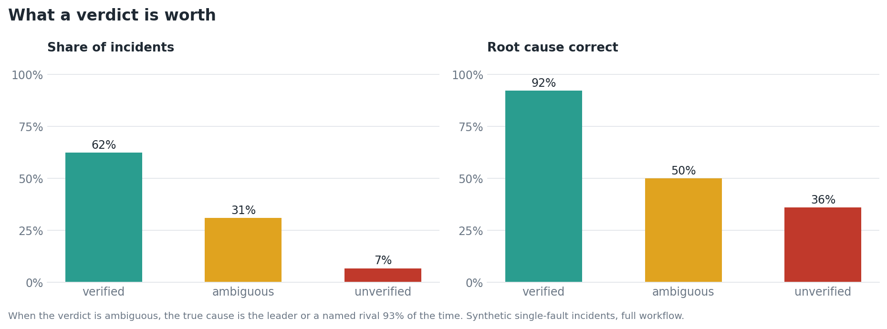

# FaultTrace

[](https://github.com/abhinavannareddy/faulttrace/actions/workflows/ci.yml)


**Root-cause diagnosis for trucks, cars, buses and construction equipment, from one codebase.**
It reads a burst of diagnostic trouble codes, names the most likely failed component, checks that
answer by simulation, says plainly when it cannot tell two candidates apart, and hands the technician
an inspection plan ordered by expected effort.

When a heavy vehicle develops a serious electrical fault, it rarely logs one clean error. The engine
ECU, the brakes, the dashboard and the fuel system all start throwing codes within a fraction of a
second, and the component that actually failed may not log anything at all. The usual shortcut, "blame
whatever reported first", sends the technician to the wrong part.

FaultTrace works backwards from the symptoms. A vehicle is a graph of components with "a fault in A can
make B misbehave" links, and a YAML file describes it. The same code serves every vehicle: the four
examples in `config/vehicles/` (truck, car, bus, excavator) and a heavy-duty truck that reports J1939
SPN/FMI codes.

## What a technician gets

A truck logs ten codes within about 200 ms. The earliest belongs to the engine ECU, so a first-code rule
blames the engine ECU. FaultTrace reports (`python -m faulttrace diagnose truck ...`):

```text
Verdict: VERIFIED
Most likely root cause: power_dist (model probability 0.729). Re-simulating the fault
reproduces the observed codes (overlap 0.769).

Inspection plan (best value per minute first):
  1. power_dist  (probability 0.875, about 40 min)
     Measure supply voltage and ground drop under load; inspect fuses, terminals and connectors
  2. alternator  (probability 0.067, about 40 min)
  3. battery     (probability 0.063, about 40 min)
  4. abs_ecu     (probability 0.049, about 35 min)
```

The power distribution unit raises no code of its own. It is found only because its failure explains a
spread of codes that no single reporting component does.


### When it cannot tell

Some faults look identical in the logs. In the car model the steering ECU raises no code and has one
downstream part, the power steering, so a fault in either produces the same codes. Guessing would be
wrong half the time. FaultTrace says so instead:

```text
Verdict: AMBIGUOUS
Leading hypothesis: power_steering (probability 0.481), but steering_ecu cannot be ruled out from the
codes. Follow the inspection plan.

Why this is not certain:
  steering_ecu is upstream of power_steering: a fault in steering_ecu produces the same codes as one in
  power_steering plus whatever steering_ecu breaks elsewhere, so the codes alone cannot separate them.
```

This matters in practice: an "ambiguous" verdict still contains the true cause 93% of the time.

## What it is worth (synthetic incidents)



| Verdict | Share of incidents | Root cause correct |
|---|---|---|
| verified | 62.3% | 92.2% |
| ambiguous | 30.9% | 50.0% (true cause in the named group: 93.0%) |
| unverified | 6.8% | 36.0% |

A "verified" result can be trusted far more than the 75% overall accuracy suggests, and the other two
verdicts tell the technician to check before replacing anything.


| Vehicle | Incidents | FaultTrace top-1 | FaultTrace top-3 | Set-cover rule | Earliest-code rule | Silent-root incidents | Silent: FaultTrace / set-cover / earliest |
|---|---|---|---|---|---|---|---|
| truck | 193 | 70.5% | 92.7% | 68.9% | 61.7% | 56 | 30.4% / 21.4% / 0.0% |
| car | 183 | 74.3% | 94.0% | 74.9% | 62.8% | 53 | 37.7% / 35.8% / 0.0% |
| bus | 190 | 77.9% | 94.2% | 76.8% | 60.5% | 57 | 56.1% / 52.6% / 0.0% |
| excavator | 188 | 78.2% | 94.1% | 75.0% | 57.4% | 62 | 72.6% / 58.1% / 0.0% |
| **all** | 754 | 75.2% | 93.8% | 73.9% | 60.6% | 228 | 50.0% / 42.5% / 0.0% |

Read this table honestly. The **set-cover rule** (pick the component whose downstream reach covers the
most observed codes, which is what a careful technician does with a wiring diagram) gets 73.9%, so the
overall accuracy gain over a good rule is only 1.3 points. The gain is larger where it matters, on
silent root causes (50.0% against 42.5%), and the verdicts above are the larger part of the value.
Accuracy cannot go much higher: comparing the observation with whole simulated code sets, which
approximates the best possible ranking for this generator, reached 74.9% against 74.4% for the
ranking used here. The remaining errors are cases that are identical in the data
([docs/ERROR_ANALYSIS.md](docs/ERROR_ANALYSIS.md)).

More checks, all in `python -m faulttrace.evaluate`:

- **Wrong edge weights.** Incidents generated with edge probabilities from 0.6 to 1.0 while the
  diagnoser assumes 0.9: top-1 67.3%, top-3 90.3%, against 64.9% for the set-cover rule and 57.8% for
  the earliest-code rule. Accuracy degrades gradually.
- **Two simultaneous faults.** When FaultTrace claims two faults it is right that there are two 94.3%
  of the time, and names exactly the right pair 57.2% of the time. It claims a pair in 30.1% of the
  double-fault incidents, and otherwise its leading answer still contains a true cause 79.2% of the time.
- **Fleet failure rates.** With uneven failure rates configured, top-1 rises from 72.6% to 80.3%
  (made-up rates; the point is the size of the effect when a customer's real rates are used).

## Features

| Need | What FaultTrace does |
|---|---|
| Heavy-duty data | Decodes **J1939 DM1** messages (SPN, FMI, occurrence count), keeps the first appearance of each repeated fault, and diagnoses the log ([docs/J1939.md](docs/J1939.md)) |
| Honest uncertainty | Verdicts `verified`, `ambiguous`, `unverified`, `no_data`; names the rivals and why they cannot be separated |
| Technician workflow | Inspection plan ordered by probability per minute, using repair actions and times from the config |
| Several faults | Detects likely double faults with a high-precision flag |
| Fleet knowledge | Optional per-component `failure_rate` priors and `service` data (repair action, minutes, part) in the YAML |
| Traceability | Every diagnosis stored with an id, timestamp, software version and config hash; reproducible later |
| Closed loop | Technicians confirm the real cause; `/stats` reports **field** accuracy per verdict |
| Per-vehicle history | `GET /history/{VIN}` shows earlier diagnoses and what was confirmed |
| Integration | REST API with API-key auth and input limits, CLI, Neo4j export tested against a real server, Docker image |
| New vehicles | One YAML file, validated on load ([docs/ADDING_A_VEHICLE.md](docs/ADDING_A_VEHICLE.md)) |

## Quick start

```bash
pip install -r requirements.txt

python -m faulttrace diagnose truck P0601 P0202 P0101 P0102     # CLI, readable report
python -m faulttrace diagnose truck_j1939 --dm1-log capture.csv # J1939 log: "time_ms,hex payload" per line

uvicorn faulttrace.api:create_app --factory                      # API on :8000, docs at /docs
```

Docker (non-root, health check, database on a volume):

```bash
docker build -t faulttrace .
docker run -p 8000:8000 -v faulttrace-data:/data -e FAULTTRACE_API_KEY=change-me faulttrace
```

Details for operators are in [docs/DEPLOYMENT.md](docs/DEPLOYMENT.md) and the endpoints in
[docs/API.md](docs/API.md).

## How it works


`triage` keeps the main burst and sets aside isolated and unknown codes. `investigator` scores every
single component, and every pair among the best candidates, by the likelihood of the observed code set
under simulated fault propagation. `verifier` re-simulates the candidate and compares predicted with
observed codes, trying the next candidate if it fails (up to three). `reporter` produces the verdict,
the ambiguity analysis and the inspection plan. There is no language model in the loop on purpose:
the same input always gives the same, auditable answer. The maths and the design decisions are in
[docs/ARCHITECTURE.md](docs/ARCHITECTURE.md).

## Documentation

| Read this | For |
|---|---|
| [docs/ARCHITECTURE.md](docs/ARCHITECTURE.md) | The model, the ranking maths, ambiguity and planning, design decisions, performance |
| [docs/ERROR_ANALYSIS.md](docs/ERROR_ANALYSIS.md) | Where the diagnoser fails, the accuracy ceiling, and an experiment that did not work |
| [docs/API.md](docs/API.md) | Every endpoint with examples |
| [docs/DEPLOYMENT.md](docs/DEPLOYMENT.md) | Configuration, security, data retention, monitoring, rollout plan |
| [docs/J1939.md](docs/J1939.md) | The DM1 layout, what is supported and how to map your own signals |
| [docs/ADDING_A_VEHICLE.md](docs/ADDING_A_VEHICLE.md) | The config format, priors, service data, validation |
| [docs/RESEARCH.md](docs/RESEARCH.md) | Related work and how OBD-II, J1939 and UDS codes are structured |

## Limits

- **All data is synthetic.** The topologies, codes, repair times and failure rates in the shipped
  configs are invented, and incidents are generated by the same kind of model the diagnoser uses. The
  mismatch test makes this less circular but does not remove it, so the numbers show how the method
  behaves, not how it will do on a real fleet. The way to find out is the feedback loop: run it in
  shadow mode next to the existing process and read `/stats` ([docs/DEPLOYMENT.md](docs/DEPLOYMENT.md)).
- **The model must come from you.** A real deployment needs the customer's component graph, their
  signal-to-component mapping and, ideally, edge probabilities estimated from their own fault history.
  The shipped J1939 truck uses real SPN numbers, but which component raises which SPN/FMI is an
  illustration.
- **Accuracy has a ceiling set by the graph.** A silent component with a single downstream neighbour
  cannot be told apart from that neighbour by the codes. FaultTrace reports it as ambiguous rather than
  guessing.
- Pair detection finds about a third of double faults. It is a warning, not a complete search.
- Code timestamps are not used in the ranking. A timing term was tried and made accuracy worse at every
  weight (overall 74.4% down to 65.8%, and 65.5% down to 43.1% for large bursts), so it was removed
  ([docs/ERROR_ANALYSIS.md](docs/ERROR_ANALYSIS.md)).
- Only the current J1939 layout is decoded. UDS status bits (pending, confirmed) are not used.
- The output is decision support for a technician, not an autonomous repair decision. It has not been
  validated for any safety-related use.

## Project layout

```text
faulttrace/
  model.py      vehicle graph, config loading and validation, fault simulation, incident generator
  diagnose.py   triage, ranking (single and paired faults), verification, ambiguity, inspection plan, baselines
  agents.py     the LangGraph workflow
  j1939.py      DM1 decoder and log ingestion
  api.py        FastAPI service (auth, limits, traceability, feedback, stats)
  store.py      SQLite store for diagnoses and technician feedback
  report.py     plain-text technician report
  evaluate.py   benchmarks, writes results/
  cypher.py     Cypher export for Neo4j
  __main__.py   command line
config/vehicles/   five example vehicles (generated by tools/make_configs.py)
tools/             config generator, figure generator, error analysis
tests/             unit, API, CLI, J1939 and Neo4j integration tests
docs/              architecture, API, deployment, J1939, error analysis, research, figures
```

## Roadmap

1. Estimate edge probabilities and failure rates from a customer's logged incidents and confirmed repairs.
2. Use pending versus confirmed status (UDS) and occurrence counts as evidence.
3. Recommend the single most informative test when the top two candidates are close.
4. Search beyond pairs when a pair does not explain the burst.
5. Validate against real fault logs, with a partner, in shadow mode.

## Author

Abhinav Annareddy
