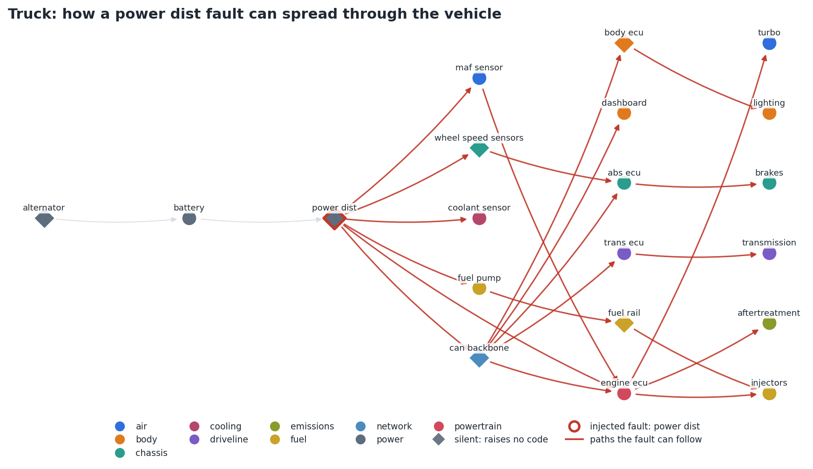
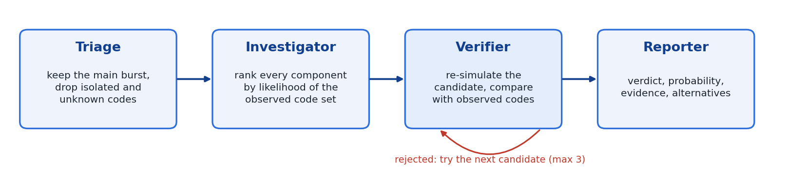
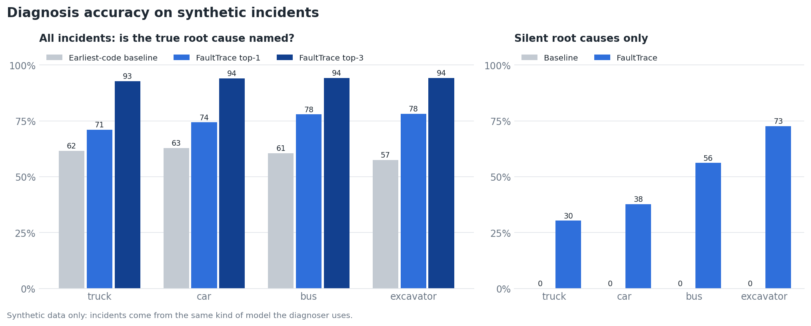

# FaultTrace

[](https://github.com/abhinavannareddy/faulttrace/actions/workflows/ci.yml)


**Root-cause diagnosis for trucks, cars, buses and construction equipment, from one codebase.**

When a heavy vehicle develops a serious electrical fault, it rarely logs one clean error. The engine
ECU, the brakes, the dashboard and the fuel system all start throwing codes within a fraction of a
second, and the component that actually failed may not log anything at all. The usual shortcut, "blame
whatever reported first", points the technician at the wrong part.

FaultTrace works backwards from the symptoms. It models a vehicle as a graph of components, asks which
single failure would most plausibly produce the codes you see, and then **re-simulates that failure to
check the answer** before reporting it.

A vehicle is just a YAML file: its components, the "a fault in A can make B misbehave" links with
probabilities, and the codes each component owns. The same code runs for the four vehicles in
`config/vehicles/` (truck, car, bus, excavator), and adding a fifth means writing one more file.

## A worked example

A truck logs ten codes within about 200 ms, from `engine_ecu`, `maf_sensor`, `fuel_pump`, `dashboard`,
`coolant_sensor`, `injectors`, `abs_ecu`, `trans_ecu`, `turbo` and `brakes`. The earliest one belongs to
the engine ECU, so a first-code rule blames the engine ECU. FaultTrace says:

```text
verdict:      verified
root cause:   power_dist  (model probability 0.883)
check:        re-simulating a power_dist fault reproduces the observed codes (overlap 0.769)
alternatives: battery, alternator, can_backbone
```

The power distribution unit raises no code of its own. It was found only because its failure explains
a spread of codes that no single reporting component does.

## How a fault spreads



A fault in the power distribution unit (red ring) can reach most of the truck, but the unit itself
raises no code. A "blame the first code" rule can never name it. FaultTrace can.

## Workflow (LangGraph)



`triage` (keep the main burst, drop isolated and unknown codes) -> `investigator` (rank every
component by the likelihood of the observed code set under simulated propagation) -> `verifier`
(re-simulate the candidate and compare predicted and observed codes; try the next candidate if it
fails, up to three) -> `reporter` (verdict, probability, evidence, alternatives).

## Run it

```bash
pip install -r requirements.txt
pytest -q
python -m faulttrace.evaluate 200        # prints the table below, writes results/latest.*
uvicorn faulttrace.api:app --reload      # POST /diagnose, GET /vehicles
python -m faulttrace.cypher truck        # Cypher to load a vehicle into Neo4j

# optional: redraw the figures in docs/ (needs matplotlib)
pip install -r requirements-dev.txt && python tools/make_figures.py
```

## Documentation

| Read this | For |
|---|---|
| [docs/ARCHITECTURE.md](docs/ARCHITECTURE.md) | The model, the ranking maths, the verifier, design decisions, performance |
| [docs/ERROR_ANALYSIS.md](docs/ERROR_ANALYSIS.md) | Where the diagnoser fails and why |
| [docs/ADDING_A_VEHICLE.md](docs/ADDING_A_VEHICLE.md) | The config format and the checks applied when loading it |
| [docs/RESEARCH.md](docs/RESEARCH.md) | Related work, how OBD-II / J1939 / UDS codes are structured |

## Using the API

```bash
uvicorn faulttrace.api:app --reload
curl -X POST localhost:8000/diagnose -H "content-type: application/json" -d '{
  "vehicle": "truck",
  "events": [{"code": "P0601", "time_ms": 3000}, {"code": "P0202", "time_ms": 3050},
             {"code": "X9999", "time_ms": 3100}, {"code": "B1001", "time_ms": 9000}]
}'
```

The response from this exact request (shortened): the two engine and injector codes form the burst,
`B1001` arrived six seconds later and is set aside, `X9999` is not a code the truck defines, and no
candidate passes the simulation check, so the verdict is honest about being a guess.

```json
{
  "verdict": "unverified",
  "root_cause": "engine_ecu",
  "probability": 0.358,
  "text": "No candidate passed simulation check. Best guess: engine_ecu (probability 0.358). A technician should confirm.",
  "codes_used": ["P0601", "P0202"],
  "codes_ignored": ["B1001"],
  "codes_unknown": ["X9999"],
  "alternatives": ["injectors", "fuel_rail", "maf_sensor"],
  "checks": [{"component": "engine_ecu", "jaccard": 0.5, "accepted": false,
              "missing_from_observation": ["P0101", "P0401"], "unexplained_by_candidate": []}]
}
```

`GET /vehicles` lists the available vehicles. Only the files in `config/vehicles/` can be requested;
anything else returns 404.

## Results (latest local run, 200 synthetic incidents per vehicle)



| Vehicle | Incidents | Simulation top-1 | Simulation top-3 | Earliest-code baseline | Silent-root incidents | Silent: ours / baseline |
|---|---|---|---|---|---|---|
| truck | 193 | 71.0% | 92.7% | 61.7% | 56 | 30.4% / 0.0% |
| car | 183 | 74.3% | 94.0% | 62.8% | 53 | 37.7% / 0.0% |
| bus | 190 | 77.9% | 94.2% | 60.5% | 57 | 56.1% / 0.0% |
| excavator | 188 | 78.2% | 94.1% | 57.4% | 62 | 72.6% / 0.0% |
| **all** | 754 | 75.3% | 93.8% | 60.6% | 228 | 50.0% / 0.0% |

With model mismatch (incidents generated with edge probabilities between 0.6 and 1.0, diagnosed
assuming 0.9): top-1 67.4%, top-3 90.2%, baseline 57.8%.

LangGraph workflow on 147 incidents: the verifier accepted 93.2%, and 81.8% of those accepted
diagnoses were correct.

Numbers vary slightly with seeds; `python -m faulttrace.evaluate 200` reproduces them.

## Where it fails

Accuracy depends on how much evidence there is: 71% with one or two codes, 85% with three to five,
and 64% when ten or more codes appear (large bursts come from faults high up in the power and network
backbone, where several candidates explain almost the same codes). The most common single mistake is
a silent component being confused with its only downstream neighbour, as in steering ECU versus power
steering. These two look nearly identical to any ranking method, which is a property of the graph and
not something tuning can fix. Details and numbers are in
[docs/ERROR_ANALYSIS.md](docs/ERROR_ANALYSIS.md).

## Limits

- **All data is synthetic.** The vehicle topologies and DTC codes are invented, and the incidents
  are generated by the same kind of model the diagnoser uses. The mismatch test above makes this
  less circular but does not remove it, so the numbers show how the method behaves, not how it would
  do on real vehicles.
- The "earliest code" baseline is deliberately simple. Real diagnostic tools are stronger.
- Neo4j is optional: the model runs on NetworkX, and `faulttrace.cypher` only prints the load
  statements. They have not been tested against a Neo4j server.
- Codes follow the OBD-II format (`P0601`) but are invented. Heavy-duty vehicles really report J1939
  SPN/FMI pairs, which this project does not model.
- Only one simultaneous root cause is considered, and the order of codes in time is not used for ranking.
- The workflow uses LangGraph for orchestration but no language model. Reports are templated text.

## Project layout

```text
faulttrace/
  model.py      vehicle graph, config loading and validation, fault simulation, incident generator
  diagnose.py   triage, likelihood ranking, simulation check, earliest-code baseline
  agents.py     the LangGraph workflow
  api.py        FastAPI service
  evaluate.py   benchmark against the baseline, writes results/
  cypher.py     prints Cypher to load a vehicle into Neo4j
config/vehicles/   the four example vehicles (generated by tools/make_configs.py)
tools/             config generator, figure generator, error analysis
tests/             20 tests: configs, propagation, triage, verifier, workflow, API, evaluation
docs/              architecture, error analysis, research notes, figures
```

## Roadmap

Ordered by how much I expect each to help, with the reasoning in the linked documents.

1. Use code timestamps in the ranking, to separate a silent component from its neighbour.
2. Return the single most informative test to run next when the top two candidates are close.
3. Allow two simultaneous causes.
4. Estimate edge probabilities and priors from logged incidents instead of assuming 0.9.
5. Model J1939 SPN/FMI codes and UDS status bits (pending versus confirmed) as evidence.

## Author

Abhinav Annareddy
